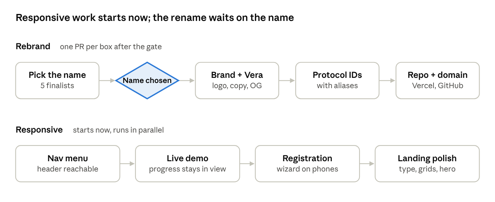

# Rebrand + Mobile/Tablet UX Plan

Nov 2, 2026 · Living version: https://claude.ai/artifact/5QnnUifVZK9Ltsd67YgDEp

## Summary

We pick a new name first, then rename everything that says Vero, Vera or ZKX, keeping old protocol IDs working as aliases, and rebuild the phone and tablet layouts of the four main surfaces. The name decision gates the rename; the responsive work can start in parallel because it doesn't depend on the name.

- **Rename depth:** everything, with aliases: brand, the Vera assistant, protocol identifiers, env var, repo, Vercel project and domain.
- **Responsive scope:** navigation, landing page, live demo widget, registration wizard.
- **Delivery:** small PRs, each checked on a Vercel preview at phone and tablet widths before merge.

## Phase 1 — Pick the name

The name is chosen before any rename code is written, because it fixes every identifier downstream (domain, protocol prefix, env var prefix, package scope).

**Criteria a candidate must pass**

| Criterion | Why it matters here | How we check |
| --- | --- | --- |
| Fits the audience | The site now speaks to banks and compliance teams, not only developers | Read it aloud in the hero: "\<Name>: Know Your Agent for Agentic Banking" |
| Short protocol prefix | It becomes the wallet-standard feature, e.g. `<prefix>:kyc` | 3–6 lowercase letters, no hyphen |
| Domain available | Replaces `zkx-psi.vercel.app` | .com or .xyz/.id/.network registrar check |
| GitHub org/repo free | Repo will be renamed | github.com/\<name> and repo name lookup |
| npm scope free | Future SDK package `@<name>/sdk` | npmjs.com scope lookup |
| No trademark conflict in fintech | Avoids a forced rename later | USPTO / EUIPO search, classes 9, 36, 42 |
| Doesn't collide with crypto projects | Agentic-payments space is crowded | Search CoinGecko, GitHub, X |

**Process**

1. Brainstorm 15–20 candidates across three directions: proof/verification words, identity/trust words, invented words.
2. Cut to 5 on the criteria above.
3. Run availability checks on the 5 and record results in a table here.
4. Decide, and pick the assistant's new name to match (or keep a neutral name like "Guide").

**Open questions**

- [ ] Keep "Vera" as the assistant even if the protocol name changes?
- [ ] Budget for a premium domain, or only standard-price ones?
- [ ] Should the founder's company (BitBasel Inc) appear in the brand?

## Phase 2 — Rename inventory

The name lives in five layers across about 35 files; only the protocol and storage layers need aliases, everything else is a straight replace. `<new>` = the chosen name, `<prefix>` = its short lowercase form.

| Layer | Where (mentions) | Change | Alias needed? |
| --- | --- | --- | --- |
| Visible brand | `page.tsx` (47), `Logo.tsx`, `public/logo.svg`, `layout.tsx` title/metadata, `opengraph-image.tsx`, `twitter-image.tsx`, `ogImage.tsx`, `register/page.tsx`, README, ROADMAP, CONTRIBUTING, docs | "Vero Protocol" → `<new>`; new logo + favicon + social images | No |
| Assistant | `VeraChat.tsx` (13), `VeroFacilitator.tsx` (8), `veraOffline.ts` (11) + tests, `/api/vera` route | Rename persona, prompts, offline answers; route `/api/vera` → `/api/assistant` | Old route redirects for one release |
| Protocol IDs | `vero:kyc` (20 uses, `VERO_KYC_FEATURE` in `ows-wallet.ts`), `vero-reveal/v1` (7, ciphertext + key-share format) | `<prefix>:kyc`, `<prefix>-reveal/v1` | Yes: accept old feature name; read old format on stored ciphertexts and share files |
| Config | `VERO_REVEAL_PUBLIC_KEY` (14), CLI `scripts/vero-reveal.ts`, `npm run reveal` | `<PREFIX>_REVEAL_PUBLIC_KEY`, `scripts/<prefix>-reveal.ts` | Yes: read old env var as fallback |
| Storage and IDs | localStorage `zkx_agent` (2), tx ids `zkx_<ts>` (2), CSS `zkx-orb-pulse`, Tailwind `zkx` colours | New keys and prefixes | Migrate `zkx_agent` once on load; old tx ids stay valid in audit logs |
| Infrastructure | GitHub repo `ZKX-Zero-Knowledge-Proof-for-Agentic-Banking`, Vercel project `zkx`, domain `zkx-psi.vercel.app`, `package.json` name | Rename repo + project, add custom domain | GitHub redirects old repo URLs; keep `zkx-psi.vercel.app` pointing to the same project |

Not affected: Redis keys (`agent:`, `audit:`, `challenge:`, `dynamic:`) carry no brand, so registered agents and audit trails survive the rename untouched.

## Phase 3 — Rename rollout with aliases

New names become the default on day one; old names keep working for a 90-day transition window, then are removed in one cleanup PR. Nothing already stored (ciphertexts, key shares, audit records, registered agents) has to be rewritten.

1. **Protocol IDs.** Register `<prefix>:kyc` as the wallet-standard feature and also register `vero:kyc` pointing at the same implementation, marked deprecated in its metadata.
2. **Ciphertext and key formats.** Write `<prefix>-reveal/v1`; the reader in `src/zkp/reveal.ts` and the CLI accept both `vero-reveal/v1` and the new tag. Existing audit-log ciphertexts and the shares in `~/vero-consortium/` keep working.
3. **Env var.** Read `<PREFIX>_REVEAL_PUBLIC_KEY` first, fall back to `VERO_REVEAL_PUBLIC_KEY`, and log a one-time warning when the fallback is used. Set the new var in Vercel, redeploy, then delete the old one.
4. **Assistant route.** Add `/api/assistant`; `/api/vera` returns the same response for the window.
5. **Browser storage.** On load, copy `zkx_agent` to the new key and delete the old one, so returning demo users keep their agent.
6. **Repo, Vercel and domain.** Rename the GitHub repo (GitHub redirects old URLs and clones), rename the Vercel project, add the new custom domain as primary, keep `zkx-psi.vercel.app` as an alias. Update README badges and links.
7. **Cleanup PR after 90 days.** Remove `vero:kyc`, the env fallback, the `/api/vera` route and the localStorage migration. The `vero-reveal/v1` reader stays permanently, because old ciphertexts may need decrypting years later.

**Risk:** an outside integrator hard-coding `vero:kyc`. Mitigation: deprecation note in README and the feature metadata, plus the 90-day window.

## Phase 4 — Mobile/tablet audit findings

The biggest problems are an unreachable mobile nav, a demo whose proof progress scrolls out of view on phones, and tablets getting the phone layout everywhere below 1024 px. These come from reading the code; each is confirmed on real widths in Phase 5's first step before fixing.

| Area | Finding | Impact | Where |
| --- | --- | --- | --- |
| Navigation | Below 768 px only "Live Demo" shows; Register Agent, GitHub, Founder and OWS are hidden with no menu | High: registration unreachable from the header on phones | `page.tsx` nav, `hidden md:flex` |
| Live demo | Below 1024 px the two panels stack; the proof progress and result panel sit under the controls, out of view while a 13–25 s proof runs | High: users think it froze | `DemoWidget.tsx` `lg:grid-cols-5`, `lg:col-span-3/2` |
| Live demo | Amount presets are a fixed 3-column grid, tight at 320–375 px | Medium | `DemoWidget.tsx` `grid-cols-3` |
| Tablet (768–1023 px) | Demo, hero and facilitator all use the single-column phone layout; wide screen space is wasted and the page gets very long | Medium | `lg:` breakpoints throughout |
| Registration wizard | "What you get" is 3 columns at every width; "Vero Protocol compliance" wraps badly in \~95 px cards | Medium | `AgentRegistrationWizard.tsx` `grid-cols-3` |
| Registration wizard | Almost no responsive classes (2 `sm:` uses in 551 lines) | Medium | whole file |
| Landing — stats | "Why now" figures (69,000+, 165M+, $50M+) fixed at 3 columns | Low–medium | `page.tsx` stats grid |
| Landing — hero | Vera facilitator panel fixed at 288–384 px wide | Low | `page.tsx` `w-72 md:w-80 lg:w-96` |
| Typography | 103 `text-xs` (12 px) uses on the landing page and 4 at 9–10 px, too small for body copy on phones | Medium | `page.tsx` |
| Touch targets | Several buttons are `text-xs` with `py-1.5`, about 28 px tall; 44 px is the usual minimum | Medium | nav links, demo controls |
| Assistant chat | Panel already caps at screen width and height; on phones it covers the demo when open | Low | `VeraChat.tsx` |

## Phase 5 — Responsive UX/UI changes

We design for three widths: phone (< 640 px), tablet (640–1023 px, a real layout instead of the phone one) and desktop (≥ 1024 px, unchanged unless the new brand changes it). Each area ships when its checks pass at 375, 768 and 1024 px.

**Navigation**

- Hamburger button below 768 px opening a full-width sheet: Live Demo, Register Agent, Founder, GitHub, OWS.
- Sheet closes on link tap and on Escape; focus is trapped while open.
- Sticky "Live Demo" stays visible in the bar on phones.
- Check: every header link reachable at 375 px with one tap after opening the menu.

**Landing page**

- Body copy from `text-xs` to `text-sm` on phones; nothing below 12 px.
- Stats grids: 1 column under 640 px, 3 columns from 640 px.
- Hero: facilitator panel goes full width (max 28 rem) under 1024 px; side-by-side from 1024 px.
- Card grids (features, how-it-works): 2 columns on tablet instead of 1.
- Check: no horizontal scroll at 320 px; hero headline fits in 3 lines at 375 px.

**Live demo widget**

- Tablet: two panels side by side from 768 px (controls left, status right).
- Phone: when proving starts, scroll the progress panel into view and show a sticky progress bar with elapsed seconds and the step ("Generating proof… 12 s").
- Amount presets: 2 columns plus a full-width custom input under 375 px.
- Result card (approved, tx link, reveal escrowed) appears directly under the button that triggered it.
- Check: on a 375 px screen, the user never has to scroll to see that a proof is running or what happened.

**Registration wizard**

- "What you get" cards: 1 column on phones, 3 from 640 px.
- Step indicator: numbers only on phones, numbers + labels from 640 px.
- Inputs and primary buttons at least 44 px tall; primary button full width on phones.
- Check: complete all three steps at 375 px without zooming.

**Across all areas**

- Touch targets ≥ 44 × 44 px.
- Assistant chat opens as a bottom sheet on phones and closes when the demo starts proving.

## Testing and verification

Every PR is checked on its Vercel preview at five widths before merge, plus one real phone and one real tablet before each phase closes.

| Width | Stands for | Must pass |
| --- | --- | --- |
| 320 px | Small Android, iPhone SE (1st gen) | No horizontal scroll; text readable without zoom |
| 375 px | iPhone SE / 13 mini | Nav menu, full demo run, full registration |
| 430 px | iPhone Pro Max | Same as 375 px |
| 768 px | iPad portrait | Tablet layouts: demo side by side, 2-column cards |
| 1024 px | iPad landscape, small laptop | Desktop layout unchanged from today |

- [ ] Screenshots at each width attached to the PR (Chrome device toolbar or a screenshot service run against the preview URL).
- [ ] Live demo run end to end on a real phone: reveal proof, approval, settlement link.
- [ ] Lighthouse mobile score recorded before and after (performance, accessibility).
- [ ] Rename PRs: the existing 82 tests pass, plus new tests for each alias (old feature name, old env var, old ciphertext format, old localStorage key).
- [ ] After the domain switch: old `zkx-psi.vercel.app` links and old GitHub URLs still resolve.

This machine can't render pages yet (no browser automation installed), so screenshots come from your browser or from a tool we add for it.

## Sequencing, PRs, risks and open decisions

Start the responsive track now and land it before the brand PR, so the rename is a clean text swap over finished layouts instead of a merge fight in `page.tsx`.

The only gate is the name decision; the 90-day alias cleanup follows the last rebrand PR.

**PR breakdown**

1. R1 — Mobile nav menu.
2. R2 — Live demo on phone and tablet, with in-view proof progress.
3. R3 — Registration wizard on phones.
4. R4 — Landing polish: type sizes, grids, hero, touch targets.
5. B1 — Brand and assistant: logo, favicon, metadata, social images, copy, assistant persona.
6. B2 — Protocol IDs, env var, ciphertext tag and storage keys, each with an alias and a test.
7. B3 — Repo and Vercel rename, custom domain, README links.
8. B4 — Remove aliases after 90 days (keep the old ciphertext reader).

**Risks**

| Risk | Mitigation |
| --- | --- |
| Responsive and brand PRs conflict in `page.tsx` | Land R1–R4 before B1 |
| Name fails trademark search after the domain is bought | Buy the domain and rename the repo only after the search is clean |
| Proofs take 13–25 s on slower phones | R2's progress UX; consider a lighter circuit later |
| Old links and integrations break on the domain or ID change | Keep `zkx-psi.vercel.app` as an alias; 90-day ID aliases |

**Open decisions**

- [ ] The new name (Phase 1).
- [ ] The assistant's name.
- [ ] Custom domain and registrar.
- [ ] Confirm order: responsive first (recommended) or rename first.
